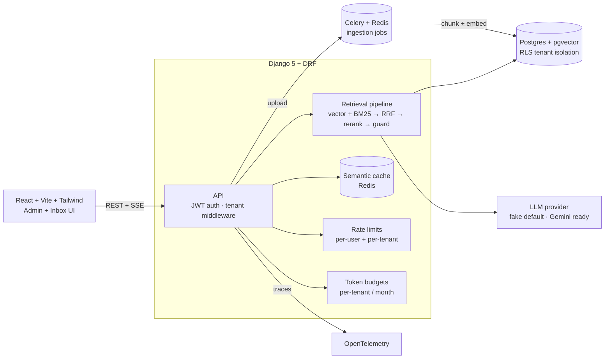

# SupportIQ — Multi-Tenant AI Support Agent Platform

A production-style AI SaaS that answers customer support questions from a
tenant's own knowledge base. Each tenant (company) gets an isolated workspace:
they upload docs (PDF/Markdown/text), the system ingests and indexes them in
the background, and a chat API answers questions with **cited sources** —
refusing to answer when the evidence isn't there.

## Why this project exists

A thin "chatbot wrapper" around an LLM API proves nothing in 2026. The hard,
unglamorous parts of shipping AI are: tenant isolation, retrieval quality,
background ingestion that survives retries, guardrails against hallucination,
rate limits, cost budgets, and observability. SupportIQ implements all of them,
with tests proving the critical paths.

## Architecture



**Request flow (chat):** `POST /api/chat/ask` → tenant resolved from JWT →
rate limits → semantic cache → hybrid retrieval (pgvector HNSW + Postgres
full-text BM25, fused with reciprocal rank fusion, reranked) → hallucination
guard (abstain if evidence is weak) → token budget check → streamed answer
(SSE) with citations → persisted to conversation history.

## 5-minute setup

**Option A — Docker (full stack, recommended):**
```bash
cp .env.example .env   # optionally set GEMINI_API_KEY + LLM_BACKEND=gemini
docker compose up --build
# Frontend: http://localhost:3000   API: http://localhost:8000/api/docs/
```
Register a workspace, create a knowledge base, upload a PDF, and ask questions
in the Inbox.

**Option B — local services (no Docker, real Postgres + Redis):**
```bash
# 1. Postgres 16 + pgvector extension, Redis running locally.
#    Create the role/database once (as the postgres superuser):
sudo -u postgres psql -c "CREATE USER supportiq WITH PASSWORD 'supportiq' CREATEDB;"
sudo -u postgres psql -c "CREATE DATABASE supportiq OWNER supportiq;"
#    The app's migrations install the vector extension automatically;
#    the role needs no superuser grant for that (CREATE EXTENSION IF NOT
#    EXISTS is a no-op once the extension exists). NOTE: keep the role a
#    NON-superuser -- Postgres superusers bypass row-level security, which
#    would silently disable the tenant-isolation DB layer (and its tests).

# 2. Backend
cp .env.example .env   # DATABASE_URL + REDIS_URL already point at localhost; set a real DJANGO_SECRET_KEY
python -m venv .venv && source .venv/bin/activate
pip install -r backend/requirements.txt
cd backend && python manage.py migrate   # installs pgvector + RLS policies
python manage.py runserver               # API on :8000 (reads .env automatically)

# 3. Celery worker (separate terminal, venv active, from backend/)
celery -A supportiq worker --loglevel=info --concurrency=2

# 4. Frontend (separate terminal)
cd frontend && npm install && npm run dev   # UI on :5173
```
Then open http://localhost:5173, register a workspace, create a knowledge
base, upload a doc (the worker ingests it in seconds), and ask questions in
the Inbox. With `REDIS_URL` set, Celery runs for real (not eager); unset
`REDIS_URL` in `.env` for the zero-dependency mode (SQLite + eager Celery +
in-memory cache) — handy for quick experiments, but the RLS tests skip there.

Smoke test (API only, no browser):
```bash
# register, create KB, upload, then ask -- see RUNBOOK.md for the curl sequence
python manage.py benchmark_cache --tenant <slug> --kb <id> \
  --question "What is the refund policy?"
```

## API overview

| Method | Endpoint | Description |
|---|---|---|
| POST | `/api/auth/register/` | Create tenant + admin user, returns JWT pair |
| POST | `/api/auth/token/` | Login (JWT access token carries `tenant_id` claim) |
| GET | `/api/auth/me/` | Current user + tenant |
| GET/POST | `/api/kb/knowledge-bases/` | List / create knowledge bases |
| POST | `/api/kb/documents/upload/` | Upload PDF/MD/TXT → queues ingestion (idempotent) |
| GET | `/api/kb/documents/?kb=<id>` | List documents with ingestion status |
| POST | `/api/kb/documents/<id>/reingest/` | Re-queue a failed ingestion |
| POST | `/api/chat/ask/` | **SSE** streamed answer with citations |
| GET | `/api/chat/conversations/` | Conversation history |
| GET | `/api/chat/budget/` | Token usage vs monthly budget |
| GET | `/api/health/` | Liveness probe (used by compose healthchecks) |
| GET | `/api/docs/` | Interactive OpenAPI docs (drf-spectacular) |

## Retrieval pipeline

1. **Embed** the question (deterministic stub by default).
2. **Vector search** — pgvector HNSW cosine on Postgres; brute-force cosine on
   SQLite (dev/tests).
3. **BM25** — Postgres full-text search; a real BM25 implementation in Python
   on SQLite.
4. **Reciprocal rank fusion** — merges the two ranked lists by rank (scores
   live on incomparable scales, so ranks are the principled choice).
5. **Rerank** — heuristic (cosine + content-term overlap) by default;
   cross-encoder via sentence-transformers behind `RERANKER_BACKEND`.
6. **Hallucination guard** — two tiers: the top chunk must clear
   `ABSTAIN_THRESHOLD`, and embedding-only matches (zero shared content terms)
   must clear the higher `ABSTAIN_SEMANTIC_ONLY_THRESHOLD`. Otherwise the
   system refuses instead of inventing an answer.

## Evals (regression-guarded retrieval quality)

```bash
pytest evals/ -s
```

14 golden Q/A pairs over a sample knowledge base. Each answer is scored for
**faithfulness** (are answer sentences supported by cited chunks?),
**answer relevance** (question↔answer embedding cosine), and **keyword recall**.
CI fails if the means regress below baselined thresholds. Wired into
`.github/workflows/ci.yml` on every push.

## Benchmarks (measured, not invented)

Semantic-cache latency, measured with the deterministic stub providers
against **real Postgres 16 + pgvector and Redis** via
`python manage.py benchmark_cache` (measured 2026-10-15 on the dev VM;
re-run on your own machine — numbers move with hardware):

| question | cold (full pipeline) | warm (cache) | speedup |
|---|---|---|---|
| What is the refund policy? | 23.9 ms | 5.3 ms | 4.5x |
| How do I reset my password? | 11.0 ms | 4.4 ms | 2.5x |
| Which payment methods do you accept? | 8.4 ms | 8.9 ms | 0.9x |

The third question isn't in the KB, so the system abstains and there's
nothing worth caching — warm re-runs the pipeline (honest 0.9x). With stub
providers the whole pipeline is already fast; the cache's value grows with
real LLM latency (seconds per answer), where a hit skips retrieval +
generation entirely. Re-run it yourself:

```bash
# from backend/, with a seeded tenant + KB (see "5-minute setup" above)
python manage.py benchmark_cache --tenant <slug> --kb <id> \
  --question "What is the refund policy?" --question "How do I reset my password?"
```

Eval harness (`pytest evals/ -s`, same stack): **faithfulness 0.91,
answer relevance 0.53, keyword recall 0.80** (mean over 14 golden Q/A;
CI fails on regression below the baselined thresholds).

## Swapping in real providers

No code changes — only env vars (see `.env.example`):

| Component | Default (no keys) | Real backend |
|---|---|---|
| LLM | `LLM_BACKEND=fake` (deterministic, cited, extractive) | `LLM_BACKEND=gemini` + `GEMINI_API_KEY` |
| Embeddings | `EMBEDDING_BACKEND=deterministic` (hash-based, 384-d) | `EMBEDDING_BACKEND=sentence-transformers` (+ pip install) |
| Reranker | `RERANKER_BACKEND=heuristic` | `RERANKER_BACKEND=cross-encoder` (+ pip install) |

Provider contracts live in `backend/llm/` (`LLMProvider`, `EmbeddingProvider`,
`Reranker`). The fake providers are deliberately *not* chatty: `FakeLLM`
answers extractively from context with citations, so local runs and evals are
fully deterministic.

## Trade-offs made (interview-ready)

- **Postgres RLS + middleware scoping vs schema-per-tenant:** RLS keeps one
  schema (simpler migrations, connection pooling) with defense in depth —
  the ORM manager fails closed without a tenant, and RLS policies fail closed
  even for raw SQL. Schema-per-tenant isolates harder but complicates
  migrations and pooling; overkill here.
- **Class-level DRF querysets are banned** with the tenant-aware manager: they
  freeze the import-time tenant into every request. All viewsets/fields build
  querysets per-request (`get_queryset()`). The test suite caught this bug.
- **Celery + Redis vs BullMQ:** Python-native stack matches Django; Celery's
  `autoretry_for` + idempotency keys + distributed locks cover the failure
  modes that matter.
- **Fail-open rate limiting vs fail-closed budgets:** if Redis dies, rate
  limits degrade to allow (logged loudly) but token budgets deny — an
  unbounded LLM bill is the worse failure mode. Tested in
  `test_chat_survives_cache_outage`; see RUNBOOK.md.
- **Deterministic stub providers by default:** zero keys, zero network, fully
  reproducible evals. The interfaces make the swap a config change, not a
  rewrite.

## Project structure

```
├── backend/
│   ├── supportiq/      # Django project: settings (env-driven), celery, urls
│   ├── tenants/        # Tenant model, middleware, RLS migration, isolation tests
│   ├── accounts/       # Custom user, JWT with tenant_id claim
│   ├── kb/             # KB models, chunking, idempotent ingestion tasks
│   ├── chat/           # SSE chat, semantic cache, rate limits, budgets
│   ├── llm/            # Provider interfaces: fake / gemini / embeddings
│   ├── retrieval/      # vector + BM25 + RRF + rerank + abstention guard
│   └── common/         # health checks, OpenTelemetry bootstrap, logging
├── evals/              # golden dataset + scorers, run by pytest and CI
├── frontend/           # React + Vite + Tailwind: admin + inbox
├── docker-compose.yml  # one-command full stack
├── RUNBOOK.md          # incident drills (one is test-backed)
└── .github/workflows/ci.yml
```

## Observability

- **Structured JSON logs** on every service (`supportiq.*` loggers) with
  request-scoped extras (tenant_id, latency, cache hit/miss).
- **OpenTelemetry** traces on API requests, Celery tasks, retrieval stages and
  LLM calls. No-op without `OTEL_EXPORTER_OTLP_ENDPOINT`; export to any OTLP
  collector when set.
- **RUNBOOK.md** documents incident drills, including a Redis-outage drill
  backed by an automated test.

## Resume bullets (draft)

- Built multi-tenant AI support platform (Django, Postgres RLS, React)
  answering questions from customer docs with cited sources; hybrid retrieval
  (pgvector HNSW + BM25 + RRF fusion) and a two-tier hallucination guard with
  a 14-question eval harness (faithfulness / relevance) in CI.
- Engineered idempotent Celery ingestion pipeline (content-hash dedup,
  distributed locks, autoretry) and per-tenant token budgets with dual rate
  limiting; semantic answer cache; OpenTelemetry tracing + RUNBOOK drills.

## Intentionally out of scope

- **Billing (Stripe/Razorpay):** the blueprint marks payments optional; token
  budgets already model the metering side. A natural follow-up.
- **Real-time collaboration on answers:** single-user chat is the correct scope
  for a support agent.
